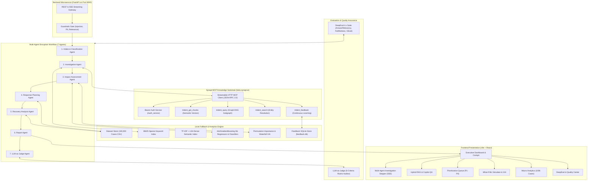

# Architecture & System Design
## AI-Powered Supply Chain Disruption Assistant with Synapt MCP

This document provides the complete architectural blueprint and design specification for the **AI-Powered Supply Chain Disruption Assistant**, built on top of the **Synapt Knowledge Substrate (MCP Connector)** and 100,000 historical disruption precedents.

---

## 1. High-Level Architecture Diagram

---

## 2. Component Breakdown

### 2.1 Synapt MCP Connector (`synapt_client.py` & `synapt_service.py`)
- **Protocol**: Model Context Protocol (MCP) over Streamable HTTP (JSON-RPC 2.0).
- **Authentication**: Bearer token session negotiation against `https://beta.synapt.ai/auth_service/api/v1/auth/token`.
- **Exposed Tools Utilized**:
  - `trident_get_chunks`: Dense semantic retrieval over ingested case documents.
  - `trident_query`: Tri-store grounded Graph-RAG query returning answers, reasoning subgraphs, and node provenance.
  - `trident_search`: Entity search across business processes and disruption episodes.
  - `trident_feedback`: Forwarding user operational ratings (`deflected`, `partial`, `not_deflected`) for knowledge-graph reinforcement.
- **Resilience**: Integrated circuit breaker pattern (opens after consecutive failures, auto-cooldown) with transparent fallback to local semantic and keyword indexes.

### 2.2 Hybrid Retrieval Engine (`retrieval.py` & `data_store.py`)
- **Reciprocal Rank Fusion (RRF)**:
  $$\text{Score}(d) = \sum_{m \in \{\text{semantic}, \text{keyword}\}} \frac{w_m}{60 + \text{Rank}_m(d)}$$
- **Semantic Leg**: Synapt vector retrieval (fallback: local TF-IDF + TruncatedSVD LSA).
- **Keyword Leg**: BM25Okapi inverted index over pre-rendered disruption case narratives.
- **Metadata Filters**: Exact SQL/pandas filtering across `disruption_type`, `industry`, `supplier_tier`, `supplier_region`, `disruption_severity`, and `has_backup_supplier`.
- **Attribute Reranking**: Blends RRF rank score with weighted incident attribute similarity.

### 2.3 Machine Learning & Explainability (`ml_models.py`)
- **Models**: Native categorical `HistGradientBoostingRegressor` and `HistGradientBoostingClassifier` trained on 100,000 cases.
  - **Targets**:
    1. Production Impact (%) — $R^2 \approx 0.70$
    2. Revenue Loss ($) — Log-transformed regression
    3. Full Recovery Days
    4. Partial Recovery Days
    5. High-Impact Disruption Risk (Binary probability thresholded at P75 loss / P75 recovery / severe impact)
- **Supply Chain Resilience Score (0–100)**: Composite index evaluating backup supplier status, tier visibility, enterprise size, impact absorption, and recovery velocity.
- **Explainable AI (XAI)**:
  - **Local Attribution**: Feature baseline delta waterfall: $\Delta_f = \text{Pred}(X) - \text{Pred}(X_{f \to \text{baseline}})$.
  - **Global Permutation Importance**: Multi-pass test partition permutation measuring feature influence on validation metrics.

### 2.4 Multi-Agent Disruption Workflow (`agents.py`)
1. **Intake & Classification Agent**: Redacts PII, guards against prompt injections, validates vocabularies, and classifies incident type and severity.
2. **Investigation Agent**: Queries Synapt MCP and local BM25 in parallel to surface the most relevant precedents and graph subgraphs.
3. **Impact Assessment Agent**: Evaluates ML predictions, generates local XAI explanations, and assigns disruption priority (P1–P4).
4. **Response Planning Agent**: Cross-references historical strategy effectiveness tables with counterfactual ML estimates to propose primary and fallback playbooks with immediate 0–72h actions.
5. **Recovery Analysis Agent**: Computes empirical cohort recovery percentiles (P10–P90) and plots chronological ramp-up milestones.
6. **Report Agent**: Drafts an executive markdown briefing highlighting situation, historical precedent, and financial exposure.
7. **LLM-as-Judge Agent**: Audits the generated briefing against retrieved evidence across 6 dimensions (Groundedness, Relevance, Actionability, Completeness, Consistency, Safety).

### 2.5 Quality & Evaluation Center (`evaluation.py`)
- **DeepEval 4.x Suite**:
  - `AnswerRelevancyMetric`: Measures semantic alignment with operational intent.
  - `FaithfulnessMetric`: Enforces zero-hallucination against retrieved historical case context.
  - `ContextualRelevancyMetric`: Validates quality of retrieved precedents.
  - `GEval` ("Recommendation Quality"): Evaluates strategic plausibility and time-boundedness.
  - `GEval` ("Impact Analysis Correctness"): Evaluates numerical consistency with predicted metrics.
- **Continuous Improvement**:
  - User feedback ratings update strategy multiplier weights ($\pm 15\%$).
  - Actual reported recovery metrics are captured as regression test cases and appended for model retraining.
