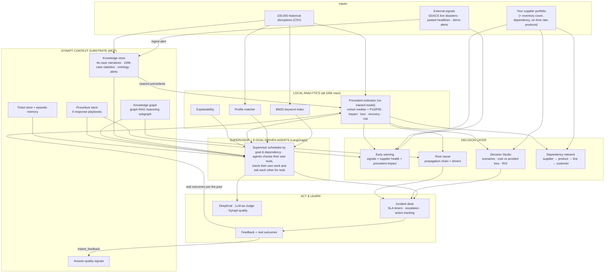
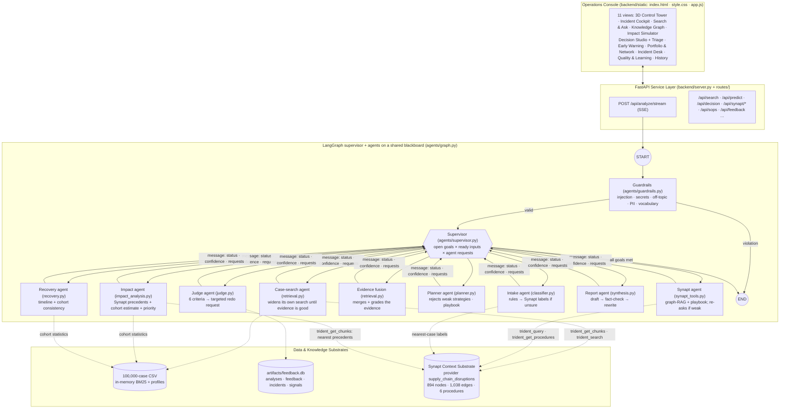

# Architecture & System Design
## AI-Powered Supply Chain Disruption Assistant with Synapt MCP

> Interactive version with diagrams and animations: [`visual/architecture.html`](visual/architecture.html). The single Synapt-backed operating mode (start-up, errors, health): [`visual/synapt-mode.html`](visual/synapt-mode.html).

This document provides the complete architectural blueprint and design specification for the **AI-Powered Supply Chain Disruption Assistant**, built on top of the **Synapt Context Substrate (MCP)** and 100,000 historical disruption precedents.

---

## 1. High-Level Architecture Diagram



**Synapt is the knowledge and reasoning substrate**: every narrative, statistic, playbook and alert the
assistant reasons over lives there, and every graph answer is scored by Synapt itself. The local layer
handles what a knowledge base cannot: statistics over all 100,000 rows (the precedent estimates), exact-profile
matching and explainability. There is no trained model: the Impact agent asks Synapt for the nearest past
cases, then reads the outcome of the closest cohort of past cases. The agents combine both; the decision layer
turns them into choices; the incident desk turns choices into tracked work whose real outcomes join the
precedent pool.

### Multi-agent orchestration (LangGraph `StateGraph`, `backend/agents/graph.py`)



**How a run unfolds (real run, 11.8 s):** the supervisor sends the description to the Intake agent; once the
incident exists, three goals have their inputs ready, so case search, the Synapt agent and the Impact agent
start **together**; evidence fusion waits for both investigation branches; the Planner waits for evidence and
impact; then Recovery, Report and Judge. If the Judge scores a criterion low, its request re-opens exactly the
goals that depend on the work it sends back. Events streamed to the console: `route` (supervisor decision +
reason), `agent_start`, `agent_step` (thought → tool → observation) and `agent_done` (summary, confidence).

---

## 2. Component Breakdown

### 2.1 Synapt MCP Connector (`synapt/synapt_connector.py`) & Synapt Tools (`agents/synapt_tools.py`)
- **Connector**: `SynaptConfig` (reads `backend/.env`) and `SynaptMCPConnector`: `authenticate()` (JSON, then
  form-encoded, against `/auth_service/api/v1/auth/token`) → `initialize_mcp()` (handshake +
  `notifications/initialized`) → `list_remote_tools()` → `call_tool()`. `call_tool` injects `provider_id`,
  `top_k` and `graph_hops` only where the live tool schema expects them, parses JSON or SSE replies, and
  re-authenticates on 401.
- **Protocol**: Model Context Protocol over Streamable HTTP (JSON-RPC 2.0, `Mcp-Session-Id`).
- **Tools layer**: `get_synapt_connector()` singleton; `fetch_synapt_rag()` (`trident_query` graph-RAG with
  reasoning subgraph and quality signals), `fetch_synapt_procedures()` / `procedure_for()`
  (`trident_get_procedures`), `get_chunks()` (`trident_get_chunks`), `search_nodes()` (`trident_search`),
  `episodes()`, `label_ticket()`, six fixed provider-pinned `trident_cypher` templates, `send_feedback()`
  (`trident_feedback`) and `stats()`. The Synapt agent (`SynaptAgent`, node `synapt_worker`) runs graph-RAG and the playbook lookup in parallel and re-asks a broader question when the answer is weak.
- **Knowledge coverage**: `knowledge_base/cases/` (4,000-case narratives), `knowledge_base/sops/` (6 response
  playbooks → Procedure Store) and `knowledge_base/reference/` (statistics over all 100,000 cases). Every
  Synapt hit is joined back to its CSV row by `DIS-` id. Loaded with `synapt/ingest_to_synapt.py`, verified
  with `synapt/test_connection.py`.
- **Region masking bridge**: Synapt's PII masking turns supplier regions into `[LOCATION_<hash>]` tokens;
  `agents/synapt_tools.regions` learns token → region (seeded in `artifacts/synapt_region_tokens.json`) and maps both ways.
- **Synapt is required (single mode)**: missing credentials or a failed handshake raise `SynaptError`; tool
  schemas come from the live `tools/list` only. Start-up (`services/bootstrap.py`) connects to Synapt first,
  then loads the data and builds the precedent pool; if Synapt is not configured or unreachable the boot stage is `error` and
  data endpoints return 503. At request time every call has a timeout and any failure raises `SynaptError`
  to the caller (`/api/ask` and `/api/synapt/*` → 502, analyses → error event); `/api/health` → `synapt`
  reports `configured`, `last_failed_tool`, `last_error`, `provider_id`, `mcp_url` and `region_tokens_learned`.

### 2.2 Hybrid Retrieval Engine (`agents/retrieval.py` & `services/data_store.py`)
- **Reciprocal Rank Fusion** (`reciprocal_rank_fusion`):
  $$\text{Score}(d) = \sum_{m \in \{\text{semantic}, \text{keyword}, \text{profile}\}} \frac{w_m}{60 + \text{Rank}_m(d)}$$
- **Semantic leg** (`semantic_search_synapt`): Synapt `trident_get_chunks` (hits joined to the CSV by `DIS-` id; `semantic_source` = `synapt`);
  `trident_search` adds knowledge-graph nodes (playbook procedures and steps) as supporting knowledge.
- **Keyword leg** (`lexical_search`): BM25Okapi over pre-rendered case narratives.
- **Profile leg** (`profile_matches`): vectorised attribute match over all 100,000 rows.
- **Metadata filters** on `disruption_type`, `industry`, `supplier_tier`, `supplier_region`,
  `disruption_severity`, `has_backup_supplier`, `response_type`.
- **Attribute reranking**: 0.5 × fused score + 0.5 × weighted attribute similarity.

### 2.3 Precedent estimates & explainability (`agents/precedent.py`) — no trained model
- **Synapt precedents**: `trident_get_chunks` with the incident's profile returns the nearest past cases
  (joined to the CSV by DIS- id); those with attribute similarity ≥ 0.75 are kept and their similarity-weighted
  median outcomes are attached to every estimate as evidence and as a cross-check.
- **Cohort estimate**: the past cases that share the incident's profile on
  `severity → size → tier → industry → backup → response-time band → strategy → type → region`; attributes are
  dropped from the end (least telling first, order chosen on a hold-out) until at least 30 cases match. The
  estimate is the cohort median, the range its P10–P90, the risk its share of high-impact outcomes
  (top-quartile loss, top-quartile recovery or ≥ 50 % impact).
- **Why not Synapt's neighbours alone?** Measured on 40 held-out cases, Synapt's nearest cases alone were less
  accurate (recovery MAE 35 d vs 25 d; impact 9.9 vs 7.8 pts) and blending them in did not help, so Synapt
  supplies the precedents and the cross-check, and the cohort supplies the numbers.
- **Hold-out check** (`scripts/validate_precedent.py` → `artifacts/precedent_validation.json`, 19,921 unseen cases):
  1. Production Impact (%) — R² 0.68 (MAE 7.9 pts)
  2. Revenue Loss ($) — R² 0.33
  3. Full Recovery Days — R² 0.35
  4. Partial Recovery Days — R² 0.17
  5. High-Impact Risk — AUC 0.87
  P10–P90 coverage 77–79 %. The gradient-boosting models this replaced scored R² 0.70 / 0.33 / 0.40 and AUC 0.87.
- **Resilience score (0–100)**: backup supplier, tier, size, recovery speed, impact absorption.
- **Drivers and what-if**: $\Delta_f = \text{cohort}(X) - \text{cohort}(X_{f \to \text{baseline}})$, where both
  cohorts keep attribute $f$ and are matched on the same other attributes (each side ≥ 100 cases), so the
  difference comes from $f$. Global: the share of outcome variance each attribute explains on its own (η²).

### 2.4 Supervisor and goal-driven agents (`agents/base.py`, `agents/supervisor.py`, `agents/graph.py`)

**What makes them agents, not if/else steps.** Every worker subclasses `Agent` (`agents/base.py`) and runs the
same loop, with no LLM:

`perceive(state) → [ decide → act (tool) → observe ]* → reflect → commit + message`

* **Goal**: a testable statement of "done" (e.g. "≥ 3 precedents with ≥ 60 % average similarity").
* **Tools**: named capabilities the agent chooses between (Synapt MCP tools, hybrid search, precedent statistics, checks).
* **Policy** (`decide`): picks the next tool from what it has observed so far, or stops because the goal is met
  or no tool can improve the result. Every step is streamed: *thought → tool → observation*.
* **Reflection** (`reflect`): grades its own result (status `done` / `partial`, confidence 0–1).
* **Message**: posted on the shared state (the blackboard) with status, confidence, steps and **requests for
  other agents**. Agents never call each other; the supervisor acts on requests.

| Agent (node) | Goal | Tools it chooses between | Decides for itself |
|---|---|---|---|
| **Supervisor** (`supervisor`) | Every analysis goal met | — (schedules agents) | Runs every open goal whose inputs are ready, in parallel; acts on agent requests within budgets; strict-rewrite backstop; stops at all-goals-met or 25 decisions |
| **Intake** (`classifier`) | Valid incident with confident key fields | keyword rules · Synapt nearest-case labels | Asks Synapt only when type / industry / region are missing or < 0.6 confidence; keeps a label only at ≥ 0.5 agreement, otherwise says why it left it unknown |
| **Investigation — case search** (`hybrid_retriever`) | ≥ 3 precedents, ≥ 60 % average similarity | hybrid search (Synapt + BM25 + profile, RRF) with focused / broadened / type-only strategies | Judges its own evidence and widens the search up to 3 times; keeps the best result |
| **Investigation — Synapt** (`synapt_worker`) | Graph-RAG answer ≥ 0.5 confidence + playbook | `trident_query` + `trident_get_procedures` (parallel) · broader `trident_query` | Re-asks a broader question when the answer is missing or weak; keeps the stronger one |
| **Evidence fusion** (`evidence_fusion`) | One graded evidence set | merge graph-RAG cases | Adds cases Synapt cited that search missed; grades evidence from similarity + Synapt confidence |
| **Impact** (`impact_analyzer`) | An estimate it can stand behind | Synapt precedents (`trident_get_chunks`) · cohort estimate + drivers · priority | Asks Synapt for the nearest past cases first; cross-checks the cohort estimate against them; lowers confidence and flags it when they disagree by > 50 % or Synapt finds < 5 close cases |
| **Planner** (`planner`) | Primary strategy with ≥ 30 comparable cases + playbook steps | rank strategies · fetch Synapt playbook · draft plan | Fetches the playbook itself if missing; rejects weakly supported strategies (or one the Judge asked it to drop) and re-drafts |
| **Recovery** (`recovery`) | A timeline consistent with the cohort | precedent counterfactual (same profile, chosen strategy) · cohort consistency check | Flags a projection outside the cohort's P10–P90 |
| **Report** (`synthesis`) | Every figure and case ID verified | draft · fact-check · strict rewrite · attach Synapt answer | Fact-checks its own draft and rewrites until it passes (2 rewrites, 3 in strict mode) |
| **Judge** (`judge`) | A verdict, and a precise redo when weak | six-criterion rubric audit | On "revise", sends the **weakest criterion** to the agent responsible: groundedness/safety → Report (strict), relevance → case search (focused), actionability → Planner, consistency → Planner without the current primary, completeness → Recovery |

**Supervisor policy** (`decide`): 1) act on agent requests (Judge redo, budget `MAX_REVISIONS = 1`), resetting
only the outputs that must be recomputed so the dependent goals re-open by themselves; 2) fact-check backstop
(`MAX_REPORT_ROUNDS = 2`); 3) schedule every goal that is open and whose inputs are ready, in parallel;
4) finish. Goals and their dependencies are a table (`GOALS`), not a fixed order. Every decision is streamed with
its reason and saved with the report (`decisions`), as are all agent messages (`messages`). Unit tests:
`tests/test_supervisor.py` (scheduling, dependencies, requests, budgets, the agents' own loops).

**Where the external LLM is used.** Only as the independent judge, as in the reference capstone: the
LLM-as-Judge benchmark (`scripts/llm_judge.py`, 4 rubrics), DeepEval (`scripts/deepeval_suite.py`) and
`POST /api/judge`. Classification, planning, the briefing and Q&A use rules, Synapt MCP, precedent statistics and templates.

### 2.5 Quality & Evaluation (`services/evaluation.py`)
- **DeepEval suite** (`scripts/deepeval_suite.py`): AnswerRelevancy, Faithfulness, ContextualRelevancy and two
  G-Eval rubrics over 25 golden incidents + a 10-case guardrail suite; Synapt confidence recorded per case.
  Results: [`EVALUATION_REPORT.md`](EVALUATION_REPORT.md).
- **Continuous improvement**: ratings re-weight strategies (×0.85–1.15), reported outcomes join the precedent pool,
  verdicts go to `trident_feedback`.

---

## 3. Directory Layout & File Responsibilities

```
SupplyChain/
├── backend/
│   ├── server.py                    # FastAPI microservice entrypoint (routers, startup, built UI)
│   ├── config.py                    # Path resolver + Synapt / judge-LLM settings from .env
│   ├── agents/                      # LangGraph supervisor + goal-driven agents
│   │   ├── base.py                  # Agent framework: goal, tools, decide/act/observe loop, reflect, message
│   │   ├── supervisor.py            # Supervisor: goals x dependencies x agent requests -> next agent(s)
│   │   ├── state.py                 # Shared blackboard (DisruptionAgentState), AGENTS, stream events
│   │   ├── graph.py                 # StateGraph wiring (supervisor hub), run_workflow / run_sync
│   │   ├── guardrails.py            # Input validation & guardrails_node
│   │   ├── classifier.py            # Intake agent (rules + Synapt nearest-case labels)
│   │   ├── retrieval.py             # Hybrid search + RRF; case-search agent; evidence-fusion agent
│   │   ├── synapt_tools.py          # Synapt tool functions + Synapt agent
│   │   ├── precedent.py             # precedent estimator: Synapt precedents + cohort, ranges, drivers, what-if
│   │   ├── impact_analysis.py       # Priority P1-P4 + Impact agent (precedent cross-check)
│   │   ├── planner.py               # Strategy effectiveness + Planner agent
│   │   ├── recovery.py              # Recovery agent (timeline + cohort consistency)
│   │   ├── synthesis.py             # Report agent (draft, fact-check, rewrite)
│   │   └── judge.py                 # Judge agent (rubric + redo requests) + LLM judge (evaluation only)
│   ├── routes/                      # 14 modular FastAPI routers (mounted under /api)
│   ├── schemas/                     # Pydantic request/response models
│   ├── services/                    # data store, LLM, feedback, evaluation, decision, early warning,
│   │                                # portfolio, network, incident desk, web gate, bootstrap
│   ├── synapt/                      # synapt_connector.py · ingest_to_synapt.py · test_connection.py
│   ├── scripts/                     # build_knowledge_base · validate_precedent · deepeval_suite · smoke_test
│   ├── artifacts/                   # feedback.db · synapt_region_tokens.json · eval_results.json
│   └── static/                      # console: index.html · style.css · app.js (served at /)
├── knowledge_base/                  # cases/ · sops/ · reference/ · tickets/ (ingested into Synapt)
├── documentation/                   # this folder (+ visual/ HTML pages)
└── supply_chain_disruption_recovery.csv
```

## 4. REST API Specification

All routes are mounted under `/api` (53 paths); interactive OpenAPI docs at `/docs`.

| Router (tag) | Endpoints |
|---|---|
| Health | `GET /health`, `GET /meta` |
| Agent Copilot | `POST /analyze`, `POST /analyze/stream` (SSE), `POST /ask`, `GET /analyses`, `GET /analyses/{id}` |
| Search & Triage | `POST /search`, `POST /classify`, `POST /recommend`, `POST /prioritize` |
| Prediction & Explainability | `POST /predict`, `POST /explain`, `POST /whatif`, `GET /precedent`, `POST /precedent/refresh` |
| Decision Support | `POST /decision`, `POST /rootcause`, `POST /rootcause/synapt` |
| Portfolio & Network | `GET /portfolio/sample`, `POST /portfolio`, `POST /network`, `POST /network/offline` |
| Early Warning | `POST /early-warning`, `GET /signals`, `POST /signals`, `POST /signals/fetch-live`, `PATCH /signals/{id}`, `POST /signals/{id}/synapt` |
| Incident Desk | `GET /incidents`, `POST /incidents`, `POST /incidents/seed-demo`, `PATCH /incidents/{id}`, `POST /incidents/{id}/actions`, `PATCH /actions/{id}` |
| Statistics | `GET /overview`, `GET /insights` |
| Synapt Context Substrate | `GET /synapt/ping`, `/synapt/knowledge`, `/synapt/insights/{key}`, `/synapt/procedures`, `/synapt/episodes`, `/synapt/quality`; `POST /synapt/graph`, `/synapt/label` |
| Response Playbooks | `GET /sops`, `GET /sops/{filename}` |
| Operator Feedback | `POST /feedback`, `GET /feedback/stats` |
| Evaluation | `POST /judge`, `POST /evaluate`, `GET /evaluate/status`, `GET /evaluate/results` |
| History | `GET /history`, `POST /history`, `GET /history/{id}`, `DELETE /history/{id}`, `DELETE /history` (stored in `artifacts/history.json`) |
