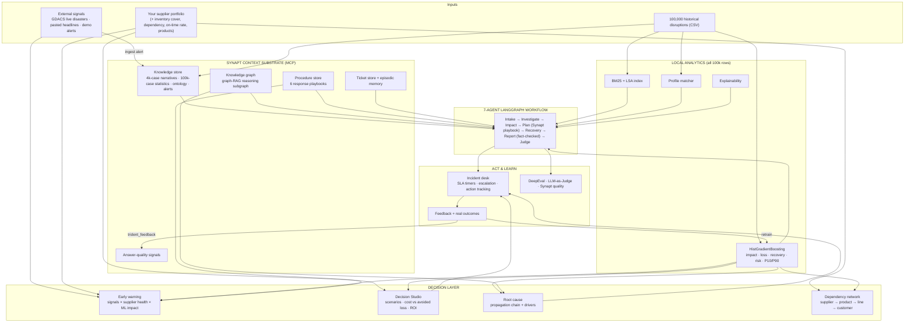
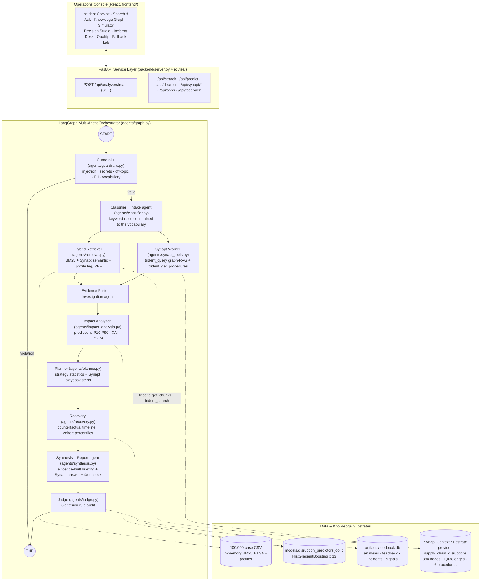

# Architecture & System Design
## AI-Powered Supply Chain Disruption Assistant with Synapt MCP

> Interactive version with diagrams and animations: [`visual/architecture.html`](visual/architecture.html). How the system behaves without Synapt or the LLM judge: [`visual/synapt-modes.html`](visual/synapt-modes.html).

This document provides the complete architectural blueprint and design specification for the **AI-Powered Supply Chain Disruption Assistant**, built on top of the **Synapt Context Substrate (MCP)** and 100,000 historical disruption precedents.

---

## 1. High-Level Architecture Diagram



**Synapt is the knowledge and reasoning substrate**: every narrative, statistic, playbook and alert the
assistant reasons over lives there, and every graph answer is scored by Synapt itself. The local layer
handles what a knowledge base cannot: numeric prediction over all 100,000 rows, exact-profile matching and
explainability. The agents combine both; the decision layer turns them into choices; the incident desk turns
choices into tracked work whose real outcomes retrain the models.

### Multi-agent orchestration (LangGraph `StateGraph`, `backend/agents/graph.py`)



The hybrid retriever and the Synapt worker run **in parallel** after classification and join in evidence
fusion. Every node streams `agent_start` / `agent_done` events, so the console shows the seven agents live.

---

## 2. Component Breakdown

### 2.1 Synapt MCP Connector (`synapt/synapt_connector.py`) & Synapt Tools (`agents/synapt_tools.py`)
- **Connector**: `SynaptConfig` (reads `backend/.env`) and `SynaptMCPConnector`: `authenticate()` (JSON, then
  form-encoded, against `/auth_service/api/v1/auth/token`) → `initialize_mcp()` (handshake +
  `notifications/initialized`) → `list_remote_tools()` → `call_tool()`. `call_tool` injects `provider_id`,
  `top_k` and `graph_hops` only where the live tool schema expects them, parses JSON or SSE replies, and
  re-authenticates on 401.
- **Protocol**: Model Context Protocol over Streamable HTTP (JSON-RPC 2.0, `Mcp-Session-Id`).
- **Tools layer**: `get_synapt_connector()` singleton; `fetch_synapt_rag()` (`trident_query` graph-RAG with
  reasoning subgraph and quality signals), `fetch_synapt_procedures()` / `procedure_for()`
  (`trident_get_procedures`), `get_chunks()` (`trident_get_chunks`), `search_nodes()` (`trident_search`),
  `episodes()`, `label_ticket()`, six fixed provider-pinned `trident_cypher` templates, `send_feedback()`
  (`trident_feedback`) and `stats()`. `synapt_worker_node` runs graph-RAG and the playbook lookup in parallel.
- **Knowledge coverage**: `knowledge_base/cases/` (4,000-case narratives), `knowledge_base/sops/` (6 response
  playbooks → Procedure Store) and `knowledge_base/reference/` (statistics over all 100,000 cases). Every
  Synapt hit is joined back to its CSV row by `DIS-` id. Loaded with `synapt/ingest_to_synapt.py`, verified
  with `synapt/test_connection.py`.
- **Region masking bridge**: Synapt's PII masking turns supplier regions into `[LOCATION_<hash>]` tokens;
  `agents/synapt_tools.regions` learns token → region (seeded in `artifacts/synapt_region_tokens.json`) and maps both ways.
- **Resilience**: one circuit breaker per tool (opens after 3 failures, 60 s cooldown) with transparent
  fallback to the local semantic and keyword indexes.

### 2.2 Hybrid Retrieval Engine (`agents/retrieval.py` & `services/data_store.py`)
- **Reciprocal Rank Fusion** (`reciprocal_rank_fusion`):
  $$\text{Score}(d) = \sum_{m \in \{\text{semantic}, \text{keyword}, \text{profile}\}} \frac{w_m}{60 + \text{Rank}_m(d)}$$
- **Semantic leg** (`semantic_search_synapt`): Synapt `trident_get_chunks` (fallback: local TF-IDF + LSA);
  `trident_search` adds knowledge-graph nodes (playbook procedures and steps) as supporting knowledge.
- **Keyword leg** (`lexical_search`): BM25Okapi over pre-rendered case narratives.
- **Profile leg** (`profile_matches`): vectorised attribute match over all 100,000 rows.
- **Metadata filters** on `disruption_type`, `industry`, `supplier_tier`, `supplier_region`,
  `disruption_severity`, `has_backup_supplier`, `response_type`.
- **Attribute reranking**: 0.5 × fused score + 0.5 × weighted attribute similarity.

### 2.3 Machine Learning & Explainability (`agents/prediction.py`)
- **Models**: native-categorical `HistGradientBoostingRegressor` / `Classifier` trained on 100,000 cases
  (`scripts/train_prediction_model.py` → `models/disruption_predictors.joblib`, metrics in
  `models/prediction_metrics.json`).
  1. Production Impact (%) — R² 0.70
  2. Revenue Loss ($) — log-transformed, R² 0.33
  3. Full Recovery Days — R² 0.40
  4. Partial Recovery Days — R² 0.27
  5. High-Impact Risk — AUC 0.87 (top-quartile loss, top-quartile recovery or ≥ 50 % impact)
- **P10–P90 ranges** from quantile models (78–80 % coverage); **cohort-statistics fallback** when the models are unavailable.
- **Resilience score (0–100)**: backup supplier, tier, size, recovery speed, impact absorption.
- **Explainability**: local attribution $\Delta_f = \text{Pred}(X) - \text{Pred}(X_{f \to \text{baseline}})$ and global permutation importance.

### 2.4 Multi-Agent Disruption Workflow (`agents/graph.py`, `agents/state.py`)
1. **Intake (guardrails + classifier nodes)**: blocks injection, secrets and off-topic text, redacts PII, validates vocabularies, classifies the incident.
2. **Investigation (hybrid retriever ∥ Synapt worker → evidence fusion)**: precedents from three retrieval legs plus the Synapt graph-RAG answer and playbook.
3. **Impact**: ML predictions with ranges, local explanations, priority P1–P4 and SLA.
4. **Planning**: strategy effectiveness × ML counterfactuals × feedback boosts; plan built from the strategy statistics with the Synapt playbook steps as its actions (no LLM).
5. **Recovery**: counterfactual timeline for the chosen strategy, cohort percentiles, milestones, resilience actions.
6. **Report (synthesis)**: briefing built from the evidence (facts, cases, strategy statistics, plan) plus the Synapt graph-RAG answer; deterministic fact-check of IDs, amounts and percentages.
7. **Judge**: six-criterion rule audit (groundedness from the fact-check, relevance, actionability, completeness, consistency, safety).

**Where the external LLM is used.** Only as the independent judge, as in the reference capstone: the
LLM-as-Judge benchmark (`scripts/llm_judge.py`, 4 rubrics), DeepEval (`scripts/deepeval_suite.py`) and
`POST /api/judge`. Classification, planning, the briefing and Q&A use rules, Synapt MCP, ML and templates.

### 2.5 Quality, Evaluation & Resilience (`services/evaluation.py`, `services/faults.py`, `services/fallback_lab.py`)
- **DeepEval suite** (`scripts/deepeval_suite.py`): AnswerRelevancy, Faithfulness, ContextualRelevancy and two
  G-Eval rubrics over 25 golden incidents + a 10-case guardrail suite; Synapt confidence recorded per case.
  Results: [`EVALUATION_REPORT.md`](EVALUATION_REPORT.md).
- **Continuous improvement**: ratings re-weight strategies (×0.85–1.15), reported outcomes retrain the models,
  verdicts go to `trident_feedback`.
- **Fallback Lab**: runtime switches that simulate outages of Synapt (all / graph / playbooks), the LLM judge,
  the models and the live feed, plus a self-test of every feature.

---

## 3. Directory Layout & File Responsibilities

```
SupplyChain/
├── backend/
│   ├── server.py                    # FastAPI microservice entrypoint (routers, startup, built UI)
│   ├── config.py                    # Path resolver + Synapt / judge-LLM settings from .env
│   ├── agents/                      # LangGraph multi-agent package
│   │   ├── state.py                 # DisruptionAgentState TypedDict, AGENTS, stream events
│   │   ├── graph.py                 # StateGraph wiring, run_workflow / run_sync
│   │   ├── guardrails.py            # Input validation & guardrails_node
│   │   ├── classifier.py            # Classification agent (intake)
│   │   ├── retrieval.py             # Hybrid retriever, RRF, evidence fusion
│   │   ├── synapt_tools.py          # Synapt tool functions + synapt_worker_node
│   │   ├── prediction.py            # ML registry: predict, ranges, explain, what-if, cohort fallback
│   │   ├── impact_analysis.py       # Priority P1-P4 + impact node
│   │   ├── planner.py               # Strategy effectiveness + response plan node
│   │   ├── recovery.py              # Recovery timeline node
│   │   ├── synthesis.py             # Briefing + fact-check node
│   │   └── judge.py                 # Rule-audit node + LLM judge (evaluation only)
│   ├── routes/                      # 14 modular FastAPI routers (mounted under /api)
│   ├── schemas/                     # Pydantic request/response models
│   ├── services/                    # data store, LLM, feedback, evaluation, decision, early warning,
│   │                                # portfolio, network, incident desk, faults, fallback lab, web gate, bootstrap
│   ├── synapt/                      # synapt_connector.py · ingest_to_synapt.py · test_connection.py
│   ├── scripts/                     # build_knowledge_base · train_prediction_model · deepeval_suite · smoke_test
│   ├── models/                      # disruption_predictors.joblib · prediction_metrics.json
│   └── artifacts/                   # feedback.db · synapt_region_tokens.json · eval_results.json
├── frontend/                        # React 19 + Vite operations console
├── knowledge_base/                  # cases/ · sops/ · reference/ · tickets/ (ingested into Synapt)
├── documentation/                   # this folder (+ visual/ HTML pages)
└── supply_chain_disruption_recovery.csv
```

## 4. REST API Specification

All routes are mounted under `/api`; interactive OpenAPI docs at `/docs`.

| Router (tag) | Endpoints |
|---|---|
| Health | `GET /health`, `GET /meta` |
| Agent Copilot | `POST /analyze`, `POST /analyze/stream` (SSE), `POST /ask`, `GET /analyses`, `GET /analyses/{id}` |
| Search & Triage | `POST /search`, `POST /classify`, `POST /recommend`, `POST /prioritize` |
| Prediction & Explainability | `POST /predict`, `POST /explain`, `POST /whatif`, `GET /models`, `POST /models/retrain` |
| Decision Support | `POST /decision`, `POST /rootcause`, `POST /rootcause/synapt` |
| Portfolio & Network | `GET /portfolio/sample`, `POST /portfolio`, `POST /network`, `POST /network/offline` |
| Early Warning | `POST /early-warning`, `GET /signals`, `POST /signals`, `POST /signals/fetch-live`, `PATCH /signals/{id}`, `POST /signals/{id}/synapt` |
| Incident Desk | `GET /incidents`, `POST /incidents`, `POST /incidents/seed-demo`, `PATCH /incidents/{id}`, `POST /incidents/{id}/actions`, `PATCH /actions/{id}` |
| Statistics | `GET /overview`, `GET /insights` |
| Synapt Context Substrate | `GET /synapt/ping`, `/synapt/knowledge`, `/synapt/insights/{key}`, `/synapt/procedures`, `/synapt/episodes`, `/synapt/quality`; `POST /synapt/graph`, `/synapt/label` |
| Response Playbooks | `GET /sops`, `GET /sops/{filename}` |
| Operator Feedback | `POST /feedback`, `GET /feedback/stats` |
| Evaluation | `POST /judge`, `POST /evaluate`, `GET /evaluate/status`, `GET /evaluate/results` |
| Fallback Lab | `GET /fallback-lab`, `PUT /fallback-lab/{switch}`, `POST /fallback-lab/reset`, `POST /fallback-lab/selftest` |
